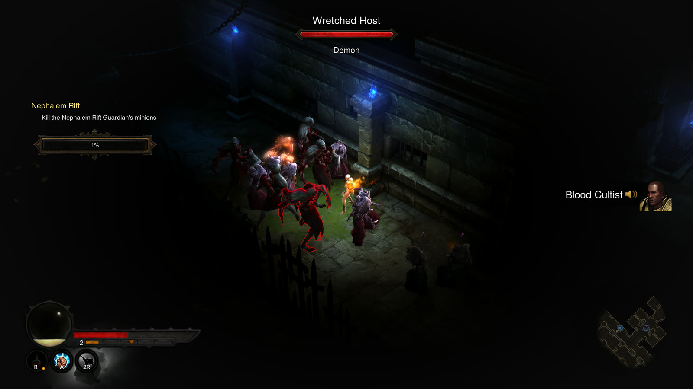

# NSD3Recomp

A native port of **Diablo III 2.7.7 (Nintendo Switch)**, the game's last update, built
by recompiling the decompiled source from
[NSDiablo3Decomp](https://github.com/loremipsum1077/NSDiablo3Decomp) for desktop
platforms. macOS on Apple silicon is the first target.

> **Not affiliated with Blizzard Entertainment or Nintendo.** This is an unofficial
> fan project, not endorsed by either company. Diablo is a trademark of Blizzard
> Entertainment, Inc.; Nintendo Switch is a trademark of Nintendo. This repository
> contains no game data, game code or Nintendo SDK material. To use it you need
> your own legally obtained copy of Diablo III: Eternal Collection for Nintendo Switch.

## Branches

- **`dev`**: 2.7.7, built from the decomp's `dev` branch. All work happens here.
- **`2.6.2`**: builds the cartridge version 2.6.2 from the decomp's `2.6.2` branch. It is
  kept as it is and changes only if 2.6.2 itself needs a fix.

## Status

**The whole game should be playable, though not all of it has been verified.**
Every decomp source file compiles and links into one macOS executable that runs from
your own game data. The campaign has been played from a cold start into Act V, and
Adventure Mode works: the world map with bounties, Nephalem Rifts opened from the
obelisk, and the Act V town. Nothing seen so far points to a part of the game that
does not work. Seen working, in play and in scripted runs on 2026-11-23:

- Start-up, the gamma and safe-area screens, the welcome dialogs and the main menu.
- Hero Creation, including the class video panel and seasonal heroes (with the
  season mod), then the intro story and the first area.
- Combat, experience and levels, skills, quests, checkpoints and waypoints, towns,
  merchants and the stash.
- Adventure Mode: bounties on the world map, the Nephalem obelisk and rifts.
- Dying, and the resurrect choices that follow.
- Saving: heroes and progress are written to `save/2.7.7/`, and the same hero loads back
  in on the next start.
- Sound, through a replacement for FMOD: in a three-minute run about 1,700 sounds
  were decoded, none failed, and up to 43 played at once.

Not verified yet, or not working:

- Every act played through to the end, each act's bosses, Greater Rifts, and the
  Necromancer and other DLC content have not been checked one by one. Please open
  an issue if something breaks.
- Hero names come from `D3_HERO_NAME` (or "Hero"): there is no on-screen keyboard.
- The first run draws nothing until shaders are translated (see Setup).
- Online features are absent by design: network calls behave like a console with
  nothing attached, and console system dialogs do nothing.
- Only macOS on Apple silicon so far.

See the [roadmap](docs/ROADMAP.md) for the detail.

## Screenshots

Captured on an Apple silicon Mac, drawn at 2560x1440 with the camera pulled back to
1.5x its normal distance (the render-size and camera mods, see [Mods](#mods)).

| | |
|---|---|
|  |  |
| Act V: the Survivors' Enclave | Adventure Mode: the world map and bounties |
|  |  |
| The Nephalem obelisk | Inside a Nephalem Rift |
|  |  |
| Act I: the gates of New Tristram | Ten kills at once: the massacre bonus |
|  |  |
| New Tristram, beside the stash | A merchant's shop |
|  |  |
| The stash, with the Signet Ring of the Blizzard | Dying in a rift |

## What is and is not in this repository

In: the build system, the platform layer that replaces the Switch SDK (system
services, graphics, audio, input), compatibility headers, and tools.

Not in, ever: game data, original executables, keys, or Nintendo SDK files. You
supply data from your own copy of the game in `game/`, which git ignores. The
decompiled game source also stays in its own repository and is referenced by path.

## Layout

| Path | Purpose |
|---|---|
| `src/host/` | Program entry, window, main loop, crash reporter |
| `src/nn/` | The Switch SDK services the game calls (`os`, `fs`, `hid`, `account`, ...), on macOS |
| `src/gfx/` | The NVN graphics driver: `metal/` draws, `null/` draws nothing |
| `src/audio/` | The FMOD functions the game uses, on a software mixer through SDL |
| `src/libc/`, `src/replace/` | Switch libc pieces and functions the decomp has no source for |
| `src/compat/` | Headers that let the decomp compile with a host compiler |
| `src/shader/` | Switch GPU instruction table used by the shader translator |
| `cmake/` | Build helpers, including how the decomp is located and how mods patch it |
| `config/` | Data symbols to extract from the dump; the list of mods |
| `tools/` | Shader translator, mods page, data extraction, progress meters |
| `docs/` | [Roadmap](docs/ROADMAP.md), [architecture](docs/ARCHITECTURE.md), [shaders](docs/SHADERS.md) |
| `game/` | **Ignored by git.** Your game dump |
| `save/`, `cache/` | **Ignored by git.** Save files; captured and translated shaders |
| `build/` | **Ignored by git.** Build output |

## Getting the game files

Nothing from the game is in this repository or the decomp, and nobody can give it to
you. You make it yourself from a copy you own:

1. **Own the game.** Diablo III: Eternal Collection for Nintendo Switch (title ID
   `01001B300B9BE000`), on cartridge or from the eShop.
2. **You need two dumps.** 2.7.7 ships no debug file, so the build also reads the one
   in the cartridge version:
   - the **cartridge version 2.6.2.52309**, with no updates installed. The title screen
     shows it in small print at the bottom (`C2.6.2.52309`);
   - the game **updated to 2.7.7** (`C2.7.7.92380`), dumped with the update applied.
3. **Dump it from your own Switch.** This needs a console that can run homebrew and
   a dumping tool such as nxdumptool, which reads the installed game with your
   console's own keys. Follow that tool's documentation. This project does not
   provide keys, firmware or instructions for getting around the console's
   protections; do not download the game or keys from anywhere else.
4. **Extract each program's ExeFS and RomFS**: 2.6.2's into `game/exefs/` and
   `game/romfs/`, and 2.7.7's into `game/2.7.7/exefs/` and `game/2.7.7/romfs/`. Allow
   about 30 GB of free space for each while extracting.
5. **Check the 2.6.2 dump** from the decomp checkout:
   `python3 -B tools/verify_original_inputs.py --input-root ../NSD3Recomp/game`.
   It reports exactly which file is missing or does not match. The 2.7.7 program is
   checked in the next section.

`game/` is ignored by git. Keep the dump private: do not commit, upload or share it.

## Setup

1. Check out NSDiablo3Decomp next to this repository (`../NSDiablo3Decomp`), or point
   `D3_DECOMP_DIR` at it.
2. Put your own dumps in `game/` and `game/2.7.7/` (see
   [Getting the game files](#getting-the-game-files)). The build reads 2.7.7's program
   and 2.6.2's debug file, and the game reads its data from `game/2.7.7/romfs/` when
   it runs.
3. Generate the decomp's private inputs (the 2.7.7 program as an ELF, game Protobuf
   bindings and data tables) from those dumps, once, in the decomp checkout. These are
   the steps in its README's
   [Setting up for 2.7.7](https://github.com/loremipsum1077/NSDiablo3Decomp#setting-up-for-277):

```sh
cd ../NSDiablo3Decomp
python3 setup.py
toolchain/nx-decomp-tools-binaries/macos/nx2elf ../NSD3Recomp/game/2.7.7/exefs/main --export-elf data/2.7.7/main.elf
shasum -a 256 data/2.7.7/main.elf   # b462b3f68d0afc80eb2331b2b18c96a86046ef5a459bedc2439aa7959cfa13c5
python3 tools/bootstrap_game_data.py ../NSD3Recomp/game --build-protoc
python3 tools/bootstrap_protobuf.py
cd ../NSD3Recomp
```

4. Build:

```sh
cmake --preset macos
cmake --build build/macos
./build/macos/d3
```

Requires CMake 3.24+, Ninja, the Xcode command line tools, SDL2 and LLVM
(`brew install sdl2 llvm`; LLVM supplies the static C++ library the program links).

The first run draws nothing: the game's shaders have to be translated once.
Run the program for half a minute, quit, then:

```sh
python3 tools/shader_translate.py --cache cache/shaders-2.7.7
```

and run it again. Repeat when a new area shows missing objects.

## Controls

A game controller maps by position: the right-hand face button is the Switch's A.

| Keyboard | Switch |
|---|---|
| W A S D | Left stick |
| I J K L | Right stick |
| Arrow keys | D-pad |
| Space or Return | A |
| Escape | B |
| E / Q | X / Y |
| 1 / 2 / 3 / 4 | L / R / ZL / ZR |
| Tab / Backspace | Plus / Minus |

The same table is on the Mods page (`Mods.command`).

## Useful switches

Environment variables: `D3_HEADLESS=1` (no window), `D3_LANGUAGE=fr` (a Switch
language code), `D3_PLAYER_NAME=...` (account nickname), `D3_HERO_NAME=...` (the
answer to the game's name prompt), `D3_GAME_DIR`, `D3_SAVE_DIR` and
`D3_SHADER_CACHE` (other folders than `game/2.7.7/`, `save/2.7.7/` and
`cache/shaders-2.7.7/`),
`D3_NVN_TRACE=frames` or `all`,
`D3_INPUT_TRACE=1`, `D3_INPUT_SCRIPT="5:A 8:PLUS"` (press buttons at given seconds;
`LSUP` and the like push the left stick, `RSUP` and the like the right one;
`F1`-`F3` and `F5`-`F9` press those hotkeys once),
`D3_MOUSE_SCRIPT="40:left:0.5,0.4 45:move:0.3,0.3 50:right:0.6,0.5@2"` (with the Mouse
mod: click or move at a fraction of the window at given seconds, `@` holds that long;
the real pointer is ignored), `D3_MOUSE_TRACE=1` (what each click hit),
`D3_SCREENSHOT=file.png` with `D3_SCREENSHOT_FRAME=2500`, `D3_METAL_STATS=1`,
`D3_FS_TRACE=1`, `D3_TEXTURE_LIST=1`, `D3_DRAW_LOG=<frame>` and `D3_DRAW_SWEEP=<frame>,<n>`
(list a frame's draws; leave out a different slice of them each frame, to find the
one that draws wrongly), `D3_METAL_PIPELINES=1`, `D3_SHADER_SKIP=<hash>,...`, `D3_SOUND_STATS=1` (what was decoded and how loud the output is),
`D3_SOUND_DUMP=<directory>` (first decoded samples as WAV), `D3_NO_SOUND=1`.

Arguments after `d3` go to the game as its own command line, as Blizzard's tools passed
them. `-blizzcon` starts the BlizzCon demo (use the `D3_MOD_BLIZZCON` mod instead, which
also fixes its UI). `-test badlinks` runs Blizzard's data audit: it checks every link
between the game's files, writes `\BadLinks.txt` (backslash included) in the folder the
game was started from, and quits. Nearly all of its entries are empty links; the rest
name worlds, areas and quests that were left out of the Switch build.

## Mods

A deliberate change to the game is made here, never in the decomp, which has to stay
identical to the original. A mod is a build option that compiles a patched copy of
one decomp source file in place of the original (`cmake/DecompSources.cmake`,
`tools/patch_source.py`). All mods are off by default.

The easy way to choose them: double-click `Mods.command` (or run
`python3 tools/mods.py`). It opens a page in your browser, served from this computer
only. Its Game version choice builds 2.7.7 (this checkout, in `build/macos`, or
`build/macos-277` when `build/macos` holds another build) or 2.6.2. The first 2.6.2
build sets up the 2.6.2 branches of both repositories as git worktrees in
`build/2.6.2/`, generates the decomp's game data there from your 2.6.2 dump in `game/`,
and builds with this checkout's `game/`, `save/` and `cache/shaders/`; 2.6.2 has fewer
mods. `python3 tools/mods.py --version 2.6.2` selects it at start. The page has a
switch for each mod grouped by kind, a side panel with what is switched
on, a Build button and a Start game button, and tabs for the Cheats tools and the
controls. The mods it offers are listed in `config/mods.json`: `group` is the heading
a mod sits under, `parent` puts an option inside another mod's card (the world boss
timer under Events), and `follows` hides an option the page sets itself: Seasons lists
only the themed seasons, 14 to 37, and turns on `D3_MOD_THEME=Season` with them.


- `-DD3_MOD_RENDER_SIZE=2560x1440`: draw the game at that size instead of the
  Switch's docked 1600x900. The game's memory budget for screen-sized buffers is
  raised to match. Turn it off with `-DD3_MOD_RENDER_SIZE=`.
- `-DD3_MOD_GRAPHICS=Anisotropic,TextureDetail,Sharpen,Shadows`: picture improvements,
  comma-separated. `Anisotropic` turns on 16x anisotropic filtering in the Metal renderer,
  so slanted textures such as the floor stay sharp into the distance. `TextureDetail`
  makes textures use a sharper mip level (a bias of -0.5, added to the translated
  shaders as they load, since Metal samplers have no bias). `Sharpen` runs a light
  sharpening filter over the finished picture, kept within each pixel's neighbours so
  edges get no halo; the game already smooths edges with its own FXAA pass. `Shadows`
  draws the shadow map at 2048 texels a side instead of the Switch's 1024, and raises
  the graphics memory budget to fit. `Reflections` turns on the game's reflection
  setting, which the Switch build hard-codes to off; it runs, but has not yet been seen
  on water. Ambient occlusion is not offered: the game can be made to draw it, but
  the Switch's material shaders never read it. The game's clutter and physics detail
  are already at their highest. Turn it off with `-DD3_MOD_GRAPHICS=`.
- `-DD3_MOD_CAMERA_DISTANCE=1.5`: move the in-game camera to that multiple of its
  normal distance from the hero. Turn it off with `-DD3_MOD_CAMERA_DISTANCE=`.
- `-DD3_MOD_SEASON=1`: make that season number active without the online service,
  so the Season Journey and seasonal heroes are available. The game's data holds 12 sets
  of seasonal content that repeat, so 1 to 12 already cover every Season Journey; 14 to 37
  also give that season's theme with `-DD3_MOD_THEME=Season` (the Mods page offers only
  these). Seasonal heroes belong to the season they were made in, so changing the number
  turns them into normal heroes, as when a season ended online. Leaderboards and the
  other online parts of seasons stay unavailable. Turn it off with `-DD3_MOD_SEASON=`.
- `-DD3_MOD_THEME=Season`: turn on a season theme. In 2.7.7 the themes are
  "community buffs" that Blizzard's servers switched on for a season, so offline none
  start. `Season` takes the theme of the season `D3_MOD_SEASON` makes active, from a table
  of seasons 14 to 37 in `src/mods/theme.cpp` (following
  [d3hack](https://github.com/god-jester/d3hack)'s season map; season 23's theme is built
  into 2.7.7). Otherwise the value is the buff names, comma-separated: `DoubleGoblins` (season 14),
  `DoubleBountyBags` (15), `RoyalGrandeur` (16), `LegacyOfNightmares` (17),
  `TriunesWill` (18), `Pandemonium` (19), `KanaiPowers` (20, 31), `TrialsOfTempests`
  (21), `ShadowClones,FourthKanaisCubeSlot` (22, 33), `EtherealItems` (24, 32), `SoulShards`
  (25, 30, 36), `SwarmRifts` (26), `SanctifiedItems` (27, 34), `DarkAlchemy` (28) and
  `NestingPortals` (29); the game also reads `DoubleBloodShards`, `DoubleRiftKeystones` and
  `ParagonCap`.
  The theme applies to every hero. With any theme on, the Altar of Rites and Visions of
  Enmity are on too, as in 2.7.7. Turn it off with `-DD3_MOD_THEME=`.

  **Switching themes while you play.** With the mod on (`Pick` builds it with no theme at
  the start), any season's theme can be put on at any time, on every hero in the game:
  from the Mods page's **Season theme** tab, which lists seasons 14 to 37 with a Use button
  each, or from the designer menu's Game page (F8, with `D3_MOD_DEV_TOOLS`). The page
  writes the request to `<save>/theme/request.txt`; the game takes the old theme's powers
  off and puts the new ones on within a second, through the server's own perk code. The
  choice is kept in `<save>/theme/theme.txt` for the next start; "The build's theme" goes
  back to the `D3_MOD_THEME` value. Buffs from `D3_MOD_EVENTS` stay on whatever the theme.
- `-DD3_MOD_EVENTS=Anniversary`: events Blizzard's servers ran, comma-separated.
  `Anniversary` opens the Darkening of Tristram (its portal is in New Tristram) and gives
  the anniversary buff; without it the dungeon still opens every January, from the game's
  own dates. `CowLevel` is the game's not-a-cow-level easter egg. `DoubleBloodShards` and
  `DoubleRiftKeystones` double those rewards. The first two change the defaults of the
  settings the servers would have sent; the doubles are community buffs, given as the
  theme mod gives its own. `src/mods/events.cpp`; turn it off with `-DD3_MOD_EVENTS=`.
  `WorldBoss` is our own event (`src/mods/worldboss.cpp`): every
  `D3_MOD_WORLD_BOSS_MINUTES` minutes (10 by default), while a hero is out of town and not
  in a rift, the game announces on screen and in chat that a world boss, one of the rift
  guardians, waits in an area it names, and marks a random walkable spot elsewhere in the
  hero's area on the minimap. Nothing is loaded or spawned then: the boss appears when the
  hero gets near the spot, once the game has loaded that part of the map. It then shows on
  the minimap as a quest monster, and its death is announced. The timer starts again once
  it dies or the hero leaves its area. For testing, when starting the game:
  `D3_WORLD_BOSS_SECONDS` overrides the time, `D3_WORLD_BOSS_TEST=1` lets a boss come in
  town, `D3_WORLD_BOSS_NEAR=1` puts the spot close by, `D3_WORLD_BOSS_SPOT=x,y` picks it,
  and `D3_WORLD_BOSS_TRACE=1` logs more.
- `-DD3_MOD_CHALLENGE=rotate`: Challenge Rifts offline. On the Switch the game
  downloaded each week's challenge as two files from Blizzard's servers:
  `challengerift_config.dat` (the challenge's number, times and orb multiplier) and
  `challengerift_NN.dat` (the rift, and the hero and account to play it with). Offline
  nothing arrives, so the game reads them from a folder instead: `D3_CHALLENGE_DIR`,
  else `rift_data` in the game folder. No challenge files ship with this project, as
  they hold another player's hero and account; use files you saved yourself. With
  `rotate` the distinct challenges in the folder take turns, moving on each time a reward
  is earned; a number (`-DD3_MOD_CHALLENGE=3`) always plays `challengerift_03.dat`.
  The challenge never expires, the reward cache counts offline, and leaderboards stay
  unavailable. Challenge Rifts open once a hero on the account has cleared a solo
  Greater Rift; the `rifts 70` cheat below does that. `src/mods/challenge.cpp`; turn it
  off with `-DD3_MOD_CHALLENGE=`.
- `-DD3_MOD_QOL=InstantPortal,InstantIdentify,InstantCraft`: quality-of-life changes for
  offline play, comma-separated:
  - `InstantPortal`: Town Portal skips its 3-second channel.
  - `InstantIdentify`: identifying an item, and reading the Book of Cain, take no time.
  - `InstantCraft`: the blacksmith, the Mystic and Kanai's Cube skip their waits.
  - `FreeCube`: Cube recipes keep their materials and gold. You still need them to
    start the recipe, and the item a recipe changes is still used up.
  - `GemUpgrade`: legendary gem upgrades at the Urshi always succeed.
  - `GemMax`: one upgrade takes a legendary gem straight to rank 150.
  - `AnySocket`: any gem fits any socket, legendary gems included. A normal gem gives
    no bonus where the game's table has none for it.
  - `AnySlot`: armour and jewellery go in any armour or jewellery slot. Weapons and
    off-hands stay in the hands. A hero saved wearing items this way needs the mod
    left on to load them there.
  - `NoUniqueEquip`: wear two of a unique-equipped legendary, such as a ring.
  - `AutoPickup`: walking over a legendary or set item picks it up, like gold. Items
    the hero drops stay on the ground.
- `-DD3_MOD_ANCIENTS=NoPrimals`: how legendary and set items roll ancient, for drops,
  Kadala, crafting and the Cube. `NoPrimals` keeps ancients but no primal ancients;
  `None` turns ancients off; `Ancient` or `Primal` makes every level-70 legendary and
  set item that. Only level-70 items can be ancient, as in the game.
- `-DD3_MOD_ITEM_LEVEL=70`: world drops (monsters, chests and so on) roll as if the area
  were this level, 1 to 70. Kadala, crafting and the Cube keep their own levels.
- `-DD3_MOD_LOOT=NoTormentGate`: looser drop rules, comma-separated:
  - `NoTormentGate`: items marked Torment-only drop on every difficulty.
  - `NoRestrictions`: items kept for later acts, for rifts, for hardcore heroes or for
    a season's unlocks drop anywhere.
  - `KadalaLegendaries`: every Kadala purchase is a legendary or set item.
- `-DD3_MOD_FPS=1`: a frame-rate counter in the window's top-left corner: frames per
  second, the time per frame, and how much of it the game's own work (CPU) and drawing
  (GPU) took, averaged over half a second and printed every ten seconds. `D3_FPS=0` or `1`
  when starting the game hides or shows it whatever the build says, and
  `D3_SCREENSHOT_WINDOW=1` makes `D3_SCREENSHOT` save the window, counter included.
  Turn it off with `-DD3_MOD_FPS=`.
- `-DD3_MOD_RUN_SPEED=2.0`: heroes walk, run and sprint at that multiple of the
  game's speed. Turn it off again with `-DD3_MOD_RUN_SPEED=`.
- `-DD3_MOD_CHEATS=1`: cheats for testing. In the game, F1 raises the hero to level 70,
  F2 adds 100 paragon levels and F3 adds 10,000,000 gold. While the game runs, the Mods
  page's Cheats tab can do the same, add any amount of gold, give any item, found
  by its in-game name, unlock Kanai's Cube, count greater rifts up to a tier as cleared
  solo (which opens Challenge Rifts), and give Horadric Caches from any act (for
  the game's current difficulty). Everything goes
  through the game's own level-up and item code (`src/mods/cheats.cpp`), so it is
  saved with the hero like anything earned. The page and the game exchange small
  files in `<save folder>/cheats/`; if you start the game yourself with a different
  `D3_SAVE_DIR`, write commands to that folder's `cheats/commands.txt` instead
  (`level 70`, `paragon 100`, `gold 1000000`, `item Unique_Helm_002_p1`, `cube`, `rifts 70`,
  `cache 3 5` for five act III caches, `spawn X1_LR_Boss_MorluSpellcaster_Ice boss`). The
  Cheats tab can also spawn any monster beside the hero by its actor name, as normal,
  champion, rare or boss; it suggests Rime, the ice rift guardian of the BlizzCon 2017 rift.
  Its Game rules section switches, while the game runs, the rules each kind of game is made
  with (the campaign, the PvP arenas, Challenge Rifts): reveal the minimap, health bars over
  monsters, no durability loss, gold for every kill, vendors that restock on talk, no
  experience, no Area Damage, and turning off town portals, headstones and the like. The
  page writes them to `cheats/rules.txt` in the save folder and they stay for later games;
  rules that would lose saves are not offered. Turn it off with `-DD3_MOD_CHEATS=`.
- `-DD3_MOD_MOUSE=1`: a mouse or trackpad alongside the controller. The Switch's menus
  only follow the controller, so the pointer drives them the same way: pointing at a
  menu entry selects it, a left click chooses it (A), and a click on a dialog's
  Accept or Cancel presses that button. In the game, holding the left button walks
  toward the pointer (it tilts the left stick) and holding the right button holds A,
  the primary skill, which also talks, opens and picks up. Other skills stay on the
  keyboard or controller. `src/mods/mouse.cpp`; turn it off with `-DD3_MOD_MOUSE=`.
- `-DD3_MOD_VENDOR=1`: Deckard Cain stands in New Tristram again, just up and to the
  left of the waypoint, in the story and in adventure mode, and trades. He sells custom
  legendary gems at their highest rank for 1,000,000 gold each. Each one is a copy of a
  real gem, keeping its look and power, with a new name and one more power: every so
  many kills while it is socketed in something you wear, you get a pylon's buff
  (Conduit Shard: Conduit every 10 kills; Shard of Power: Power every 25; Quickening
  Shard: Speed every 10). The gems are added to the game's item table as it loads, so
  they are saved with the hero; a hero holding one needs this mod on to load. Add gems
  in the table at the top of `src/mods/vendor.cpp`. Turn it off with `-DD3_MOD_VENDOR=`.
- `-DD3_MOD_CORRUPT=1`: Kanai's Cube gains a last page, Corrupt Legendary: 1 legendary
  item, 25 Death's Breath, 5 Forgotten Souls and 1 Corrupted Angel Flesh. The item gains
  a hidden affix holding one boss skill, picked at random from 27 (Diablo, Belial,
  Azmodan, Zoltun Kulle, Izual, Maghda, the Skeleton King, Siegebreaker, Malthael,
  Urzael, the Spider Queen and Adria), and the tooltip names it. While it is worn, each
  hit has a chance (15%, scaled by the skill's proc coefficient; at most once every 1.5
  seconds per item) to cast that skill from the hero. Corrupting the item again rerolls
  the skill. A hero holding a corrupted item needs this mod on to load. The skills are
  listed at the top of `src/mods/corrupt.cpp`. Turn it off with `-DD3_MOD_CORRUPT=`.
- `-DD3_MOD_LOAD_WORLD=X1_TEST_ChallengeTestWorld`: skip the menus and start in a
  developer test world that ships with the game but can't be reached in normal play
  (`X1_TEST_ChallengeTestWorld`, or `Axe FlatWorld`, a flat test map; any world's SNO
  name works). The game's own developer loader makes a throwaway account and hero for it,
  so your heroes are not loaded or changed. `D3_LOAD_WORLD=<name>` overrides it when
  starting the game (empty for the menus). `PvP_Duel_Small` is the PvP dueling world, a
  foggy graveyard and ruined village the Switch never sends you to. `D3_SCENE_SWAP=245724:345754`
  with `X1_TEST_ChallengeTestWorld` replaces that world's one scene with an unused test
  scene: `345754` is `x1_westm_Monster_Affix_Test`, a Westmarch courtyard on a cliff, and
  `121112` is `Test_EventLeavingLevelArea`, a bare test floor. The game's file list leaves
  both scenes out, so the mod adds them when the list is read. `src/mods/dev.cpp`; turn it
  off with `-DD3_MOD_LOAD_WORLD=`.
- `-DD3_MOD_BLIZZCON=1`: the BlizzCon show-floor demo, as `-blizzcon` starts it: an
  offline party of level-70 demo heroes, and Continue goes straight into a Greater Rift.
  Your own heroes are not changed (the game's settings file may be). The demo's title
  screen loaded fewer UI files than 2.7.7's game screens need, so the mod loads the usual
  set. Turn it off with `-DD3_MOD_BLIZZCON=`.
- `-DD3_MOD_DEV_TOOLS=1`: hotkeys for views Blizzard's developers used, which the game
  still draws once switched on. F5 cuts to a fixed camera looking at the hero from the
  front, for screenshots (the game's own, unsent, screenshot view); F5 again goes back.
  F6 shows the name of what the primary skill would hit at the top of the screen (the
  release build has no names, so it shows a code). F7 shows the left stick's position,
  magnitude and dead zone. F8 opens the designer menu, a developer menu whose layout,
  screen and button code the release still has: Character, Quest, Game, Console, Quick
  Options and Music pages. Its entry lists and every command they ran were dropped, so
  the entries are new: with `D3_MOD_CHEATS` they run cheats-page commands (level 70,
  +100 paragon, gold, the cube, caches, spawning Rime), and the quick options switch the
  F5-F7 views. The Quest page (locations, bosses, quest steps) and the Music page fill
  themselves from game data as the original did, but what they ran was a developer
  console command, which this build does not have, so choosing one only logs it.
  F9 is a free camera: it starts where the game's camera is, and the controller then
  flies it instead of moving the hero. The left stick (WASD) moves along the view and
  sideways, the right stick (IJKL) turns, R or ZR (2, 4) rises, L or ZL (1, 3) sinks, and
  holding A (Space) goes four times as fast. F9 again gives the controller back and
  returns to the normal camera. The hero stays where they are, and only what the game
  has loaded around them is drawn, so far away there is nothing to see. It is the game's
  static camera view, moved every frame.
  The free camera is also a photo mode. X (E) hides the HUD, Plus (Tab) pauses the game,
  up and down on the d-pad (arrow keys) zoom by narrowing or widening the field of view,
  left or right switches a grayscale filter, and holding B (Escape) slows the camera for
  small moves. Y (Q) takes a photo three times the window's size each way (4800x2700 at
  the usual 1600x900): the game's own tiled-screenshot setting, left from Blizzard's PC
  tools, draws one ninth of the view per frame and the tiles are stitched together.
  Minus (Backspace) takes a map: the area around where the camera looks, straight down
  with no perspective, square to the world, one tile per frame, brightened so the layout
  reads. The game pauses and the HUD hides while either is taken (a few seconds), and the
  edge-darkening colour pass is left out so the tiles meet cleanly. Pictures go to
  `~/Pictures/Diablo III` (`D3_PHOTO_DIR` to change it). `D3_PHOTO_TILES` (3) sets the
  photo's size, `D3_MAP_SIZE` (360) and `D3_MAP_TILE` (60) the map's width and the width of
  one tile in world units (the hero is about 2 tall), `D3_MAP_HEIGHT` (120) how far above
  the hero the map camera sits, and `D3_MAP_GAMMA` (55, in percent; 100 for none) how much
  the map is brightened. A whole town fits in about `D3_MAP_SIZE=700`. Only what the game
  has loaded is in a map, which in towns is all of it.
  `src/mods/dev.cpp`, `src/mods/designer_menu.inc`; turn it off with `-DD3_MOD_DEV_TOOLS=`.
- Test items: with the cheats on, the Cheats tab's item picker also lists the items
  Blizzard marked test-only or art-test (`ThorTest_Mojo`, `Sword_1H_PvP_70`,
  `Art_Test_Bow_1`, the 4v4 PvP amulets and about 400 more; choose "All items", as
  they have no rarity). Most have no in-game name.

## Measuring progress

```sh
python3 tools/compile_probe.py
```

reports how many of the decomp's source files the host compiler accepts, and the
most common reasons for the rest. To compile everything and count what is still
missing at link time:

```sh
cmake --build build/macos --target d3_decomp -- -k 0
python3 tools/link_probe.py
```

## Licence

The code in this repository is under the [MIT licence](LICENSE). That covers only
what is written here. It grants nothing for the game, its data, the decompiled
source in NSDiablo3Decomp, or anything from Nintendo's SDK. The Switch GPU
instruction table in `src/shader/` comes from envytools and keeps its own MIT
licence (`src/shader/LICENSE-envytools`).
